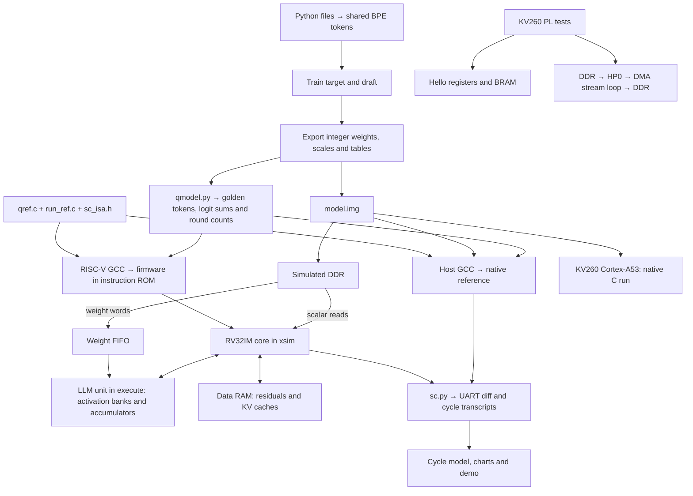

# SpecCore technical guide

## 1. System overview

SpecCore runs a draft language model and a target language model on the same RISC-V core.
The draft proposes a continuation. The target checks several positions while reading each
matrix of weights once. Firmware commits only tokens that the target would emit under greedy decoding.

With fixed γ = 2, the core took 105.46M cycles to produce the same 40 tokens that took
128.09M cycles under plain greedy decoding, summed over three prompts. The resulting
**1.215× speedup (measured)** comes from RTL simulation with ideal DDR and the branch predictor
enabled in both runs. The KV260 experiment measured how fast its DDR port could move
data through programmable logic. [Measurement log, session 11][s11]



To compute one output row, firmware fills a bank with the activation vector for each position.
The unit broadcasts the row's weight words to those banks and returns a scaled sum for each
position. In the vocabulary projection, the largest sum for each position chooses its token.

**Reading the evidence.** “(Measured)” means a recorded software run, RTL simulation,
implementation report or board test, as identified beside the value. “(Estimated)” means
a prediction or projection from those measurements. Instruction fields, addresses, scale
formats, equations and command arguments below are literal interface definitions.
The chronological [logbook](LOGBOOK.md) records the runs. The [project summary](PROJECT_SUMMARY.md)
and [decision log](review/decisions.md) identify which experiments supply the current results.

## 2. Models, training and checkpoints

### Shape of the decoder

Both models predict the next token of Python source. Each has a token embedding, a stack of
causal decoder blocks, a final RMSNorm and a vocabulary projection. The shape determines how
many bytes a pass must stream. The draft and target can still share the tokenizer and cache code.

| Recorded model configuration | Draft | Target |
| --- | ---: | ---: |
| Residual width | 128 | 256 |
| Decoder blocks | 2 | 6 |
| Attention heads | 4 | 8 |
| Dimensions per head | 32 | 32 |
| MLP hidden width | 4 × residual width | 4 × residual width |
| Vocabulary / maximum context | 2,048 / 128 tokens | 2,048 / 128 tokens |
| Float parameter count (measured, rounded) | 0.656M | 5.246M |

The logged parameter count includes each tied parameter once. The C reference specializes its
inner attention loop to the common head dimension. [Logbook, model setup][s2]
[Model card](MODEL_CARD.md) · [Model definition](../model/model.py)

A block normalizes the residual vector, projects it to queries, keys and values in a single
bias-free linear layer, and rotates queries and keys by position. Each head compares its query
to the keys at visible positions and takes a weighted sum of their values. The output
projection maps the concatenated heads back to residual width. Firmware adds this to the input.
The next RMSNorm feeds a wider linear layer, a ReLU and a projection back to residual width.
A second residual addition completes the block. The float output layer reuses the embedding
weights. During integer export, folding the final norm gain creates a separate output matrix.

### Tokenizer and data

`model/data.py` streams `codeparrot/codeparrot-clean` and filters by the per-file licence field.
It keeps MIT, Apache, BSD and ISC entries on its allowlist, skips oversized files, and splits
whole files between training and validation. File boundaries carry an end-of-text marker.

`train_tokenizer.py` learns byte-level BPE merges on a sample of the training split.
The vocabulary and merge order in `model/tokenizer/bpe2048/` determine the token IDs.
`prepare.py` encodes files, appends the end-of-text ID, and writes packed unsigned token IDs
to `data/tok2048/{train,val}.bin`. Both models must interpret every ID the same way.

The chosen vocabulary gave 2.539 characters per token on the validation sample.
The prepared training split contained 113,966,123 tokens (measured).
A larger vocabulary shortened sequences but increased the number of output rows read on every pass.
[Tokenizer comparison and corpus count][s2]

### Training and distillation

`train.py` samples windows from the token files. The target for each input is the same window
shifted by one token. Training uses AdamW, learning-rate warmup followed by cosine decay,
gradient clipping, and bfloat16 autocast on the GPU. The saved checkpoint is the best observed
on fixed validation batches. `model/check.py` checks the block shapes, causal mask, rotations
and ability to learn a small batch. [Training code](../model/train.py)

For the active draft, the frozen target also predicts a distribution on those training windows.
The draft minimizes a weighted sum of next-token cross-entropy and forward
`KL(target || draft)`. The teacher supplies logits under the same prefix the student sees.
The distillation loss penalizes missing probability mass that the target places on a token.
The training log records the mixing weight and optimizer settings for this checkpoint.
[Active draft training log](../logs/d15/d128x2_kd.train.log)

The active target saw 105M training tokens and reached validation loss 1.955 (measured).
The original draft saw 13M tokens. At γ = 2 it emitted 1.85 tokens per target pass.
Training the same draft shape on 228M tokens raised this to 2.46 without distillation.
Adding distillation at that training length raised it to 2.52, **+2.4% from distillation alone**
(measured, 200 validation prompts, float). The active draft reached validation loss 2.311.
Tokens per target pass counts emitted tokens, including the token supplied by the target.
[Training and matched-length comparison][s11]

### Which files reproduce the results

| Role | Active file or directory | How it is used |
| --- | --- | --- |
| Target | `checkpoints/target.pt` | Original target, also identified as `target_8min.pt` |
| Draft | `checkpoints/draft.pt` | Distilled `d128x2_kd`, also saved as `draft_kd_v2.pt` |
| Integer exports | `checkpoints/export/{draft,target}.npz` | Python reference loads the packed weights, scales and tables |
| Firmware image | `checkpoints/export/model.img` | Same active pair as `export_v2/`, addressable by native C and the simulated core |
| Golden outputs | `ref/golden*.h` | Prompt, greedy tokens, logit sums and expected round statistics for the active pair |

`draft_v1.pt` is the earlier, shorter-trained draft. The longer-trained target and its
re-distilled draft are `target_long.pt` and `d128x2_kd2.pt`, with integer files in `export_v3/`.
The project restored the original target and `d128x2_kd` after that experiment.
Using the existing image and headers reproduces the measured pair without retraining.
[Checkpoint decision and restored state][s12] · [Handoff](HANDOFF.md)

## 3. Speculative decoding

### One round

Let `seq` be the prompt plus all committed output tokens. A cache length counts input
tokens already processed by a model. The newest committed token can therefore exist in
`seq` before either model has consumed it. Both caches initially hold `prompt[:-1]`.

1. Reserve room for the target's own token. Set `g = min(γ, remaining_output - 1)`.
2. Compute `behind = len(seq) - 1 - draft_cache_length`. Feed the missing committed inputs.
   With guesses to make, firmware processes the catch-up inputs and the last real token
   in the same draft pass. The last lane's argmax is the first guess.
3. Feed that guess back to the draft to obtain the next guess. Repeat up to the limit.
   Each guess depends on its predecessor, so these draft passes run in sequence.
4. Save the target's starting cache length `base`. Feed `[last_real] + guesses` in one
   target pass of width `K = g + 1`. Lane `j` returns `want[j]`, the target's next token
   after the prefix ending at input position `base + j`.
5. Starting at the first guess, count consecutive positions where `guess[j] == want[j]`.
   Call this count `ok`. Append `guesses[:ok]`, then append `want[ok]`.
6. Truncate the target cache to `base + 1 + ok`. Truncate the draft cache to the smaller
   of its actual length and `len(seq) - 1`. The next write reuses discarded cache rows.

On a mismatch, `want[ok]` corrects the first wrong guess. A full match earns a bonus token. If only one output token remains, the target
consumes the last real token alone. The firmware still processes outstanding draft catch-up.

**Why the draft can fall behind.** To propose the final guess, the draft consumed the
preceding token. If the target accepts the whole run, the final guess also becomes a
committed input. The draft may still need to process it before consuming the bonus token.
Charging only the submitted guesses misses this work. [Integer loop](../model/qmodel.py)
· [Firmware loop](../ref/run_ref.c)

### A round trace from the core

These are the `RR_SPECLOG` triples from the fixed-γ golden run (measured).
The catch-up column counts previously committed inputs missing at the start of that round.
[Core transcript](../build/ref_accq_kd_bp_core.txt) · [Measurement log][s11]

| Round in order | Guesses submitted | Prefix accepted | Draft catch-up |
| --- | ---: | ---: | ---: |
| First | 2 | 2 | 0 |
| Second | 2 | 2 | 1 |
| Third | 1 | 0 | 1 |
| Last | 0 | 0 | 0 |

The first round emits both guesses and a bonus. The second starts by catching up and does
the same. The third emits a correction. The last takes a target-only step. A guess after
a mismatch was conditioned on a discarded prefix, so even a later matching ID cannot be kept.

### Confidence gate and greedy identity

Fixed γ = 2 is the default policy for the reported firmware. The optional confidence gate
uses the difference between the largest and second-largest draft logits. Equal maxima give
zero margin. Under `RR_GATE=4096` and `RR_GMAX=4`, the first guess always goes through if
there is room. Each later guess goes through only if **its own** margin exceeds one logit unit.

A refusal is a **peek**. The draft pass has already run and consumed its input. Its prediction
is omitted from the target batch, and its cost remains in the draft count. Equality to the
threshold stops the round. Python also offers `next` mode, which decides whether to launch
a pass using the previous margin. The firmware implements `peek`.
[Gate decision][s11] · [Firmware switch](../ref/run_ref.c)

Greedy identity follows by induction on the committed prefix. Before the first mismatch,
each lane sees precisely the inputs a serial target would have seen. Causal attention
prevents later guesses from affecting that lane. Both paths choose the first vocabulary
index on a tie. Every accepted guess is therefore the target's greedy choice, as is the
correction or bonus. Truncation re-establishes the prefix invariant for the next round.
The proof compares paths through the same integer target. Quantization can change a
float target's argmax. [Python reference](../model/qmodel.py)

## 4. Integer arithmetic and the golden reference

### What each integer represents

| Quantity | Representation used at inference |
| --- | --- |
| Matrix weight | Signed int8, symmetric quantization with one positive scale per output row |
| Matrix input | Signed int8 with one scale per position's activation vector |
| Residual or logit | Signed Q12 value. The integer divided by 4,096 is its real value |
| Key or value | Signed int8 vector plus its own scale per layer, head and cache position |
| Dot product | Signed accumulator before any row, activation or attention scale is applied |
| Nonzero scale | Pair `(m,e)` representing `m × 2^(-e)` with `2^29 ≤ m < 2^30` |

Python uses wider integer containers for operations and checks bounds. The exported payload
has the narrow element types consumed by the core. Export folds each learned RMSNorm gain
into the columns of the following weight matrix before quantizing its rows. It rounds each
weight using the stored row scale and clips to `[-127,127]`. A zero row carries a zero scale.
[Export and reference bring-up][s7] · [Image writer](../model/export.py)

### Multiplication, rounding and requantization

`norm_scale(num,den)` chooses an exponent so that flooring the scaled rational produces
a normalized mantissa. For a zero numerator it returns `(0,0)`. Both the floor and the
position where it occurs matter when matching Python, C and RTL.

```text
smul((am,ae),(bm,be)):
    p = am * bm
    if p == 0: return (0,0)
    r = 30 if p >= 2^59 else 29
    return (p >> r, ae + be - r)

apply(v,m,e,frac):
    sh = e - frac
    if m == 0 or sh > 62: return 0
    require sh >= 1
    return (v*m + 2^(sh-1)) arithmetic_right_shift sh
```

`smul` truncates the product of the mantissas. `apply` rounds half up, including negative
ties, which go toward positive infinity. `apply32` implements the same low signed result
for a word-sized input. For large shifts it shifts only the rounded product's signed high
word. For short shifts it stitches together bits from the high and low words. The recorded
comparison had zero mismatches in 28.8M cases (measured). [Exact shift paths][shift]

`quant` finds the vector's maximum absolute element, scales that magnitude to the positive
int8 limit, rounds and clamps each element. It also returns the scale that recovers real
units from those bytes. An all-zero vector produces zero bytes and a zero scale.

### Nonlinear operations

- **RMSNorm.** Accumulate squared Q12 residuals in a wide sum. Divide by the element
  count, add the fixed epsilon in squared units, and take the floor integer square root.
  Normalize the bytes by their maximum magnitude. Fold the reciprocal RMS into the
  vector scale. The matrix multiply then applies the normalization to the whole vector.
- **RoPE.** Use the absolute cache position to look up Q14 sine and cosine. Rotate adjacent
  query and key components with wide products, add the rounding bias, and shift back
  to Q12. The values pass through without rotation.
- **Softmax.** Scale each query-key dot by the query and key scales and the exported
  `log2(e)/sqrt(head_dim)` constant. Subtract each score from the largest visible score.
  Split the nonnegative difference into integer and fractional parts. A 256-entry Q15
  table supplies the fractional base-two exponential. A right shift applies the integer
  part, and distant positions can contribute zero.
- **Value mix.** Sum the exponential weights. Fold each cached value's scale into its
  weight, requantize the weight vector to int8, and dot it with a column of cached values.
  Apply the weight scale and reciprocal sum at readout. This order of rounding is part
  of the reference. [Integer algorithms](../model/qmodel.py) · [C implementation](../ref/qref.c)

### What bit-exact means here

`qmodel.py --golden` computes each model's greedy token and full integer logit sum at
each output step. It also checks speculative tokens against target greedy before writing
the expected round counts. `run_ref.c` checks the full sum even though its diagnostic
prints only the low word. A matching token alone would miss many arithmetic errors.

The PC build loads the same image and checks those headers. The simulated core then runs
the same C with real custom instructions. `sc.py run` compares their program output.
The arithmetic tests and instruction scoreboard exercise errors a checksum could miss. [Verification log][s11]

## 5. RV32IM core

### Pipeline and hazards

The core issues in order. Its five stages share the usual integer register file and result
forwarding network. The LLM unit sits beside the ALU in execute. [Core RTL](../core/rtl/RV.v)

| Stage | Work on an advancing instruction |
| --- | --- |
| F (fetch) | Read instruction memory at the PC. Pick the sequential or predicted next PC. A redirect from E has priority. |
| D (decode) | Decode opcode and function bits. Read registers, extend the immediate and carry the fetch prediction forward. A same-cycle W result can bypass the register file. |
| E (execute) | Forward source operands. Compute the ALU, multiply, divide or custom result. Resolve branch direction and target. |
| M (memory) | Present the effective address and aligned byte enables. Select the proper store lanes or capture memory read data. |
| W (writeback) | Select a loaded byte, halfword or word and extend as required. Write the selected result to the destination register. |

For each execute operand, the newest matching register writer wins. M has priority over W,
and a destination of `x0` cannot supply a forwarded result. If a load in E writes a
register named by either decode source field, the hazard unit holds F and D and inserts a
bubble into E. The consumer later receives the extended load result from W.

A divide, an unfinished `ACCQ` or a stream consumer waiting for data holds F, D and E.
The hazard unit bubbles M, so older instructions can retire and the held instruction
cannot write the same result twice. A branch redirect flushes the younger fetch and decode
work. The instruction resolving the branch continues to M. [Hazard logic](../core/rtl/Hazard.v)

### Branches and the M extension

The branch predictor has a direct-mapped, tagged 16-entry branch target buffer and a
two-bit saturating counter per entry. A taken branch or jump can allocate an entry.
Fetch uses the stored target on a tag hit when the counter predicts taken. Execute checks
both the direction and the target. Disabling prediction makes fetch choose the sequential
PC while the table continues to train. This predictor chooses an instruction address.
The draft confidence gate operates on token logits in firmware. [Predictor RTL](../core/rtl/BranchPredictor.v)

`MUL` selects the low word of a single-cycle DSP multiply. `MULH`, `MULHSU` and `MULHU`
set operand signedness and select the high word. `MCycle` handles restoring division.
Signed division works on magnitudes and restores the signs of quotient and remainder.
A zero divisor gives an all-ones quotient and the dividend as remainder. The divider
occupied 32 busy cycles per divide (measured). The early Booth multiplication figures
in the course-core notes describe the design before the DSP change.
[Core changes and waveform accounting][s4] · [Core facts](core_facts.md)

### Address space used by firmware

| Region | Base / size in the simulation wrapper | Contents |
| --- | --- | --- |
| Instruction ROM | `0x0040_0000` / 64 KiB | Reset entry and linked text, preloaded from `AA_IROM.mem` |
| Data memory | `0x1000_0000` / 1 MiB | Read-only constants, initialized data, BSS, stack, scratch arrays and KV caches |
| Model image | `0x2000_0000` / 8 MiB window | Read-only DDR array, initialized from `AA_DDR.mem` with `--ddr` |
| MMIO | `0xFFFF_0000` | UART status and data, seven-segment exit code and cycle counter |
| Cycle counter | `0xFFFF_00A0` | Read-only word counter used by `sc_cycles()` |

The wrapper has independent scalar and stream reads. On exit firmware writes status to SEVENSEG (`0xFFFF_0080`), polls UART ready (`0xFFFF_0008`), then sends `0x04` to TX (`0xFFFF_000C`). `crt0.S` sets up the global and stack pointers, clears BSS and calls `main`.
The linker and wrapper must agree on both memory origins. The older data origin in the
course notes belongs to the small course image. [Logged map change][unit]
· [Firmware linker script](../firmware/link.ld) · [Simulation wrapper](../core/rtl/nexys/Wrapper.v)

## 6. LLM unit and custom ISA

### Lane state and commit

Each of the eight lanes contains an activation bank of 256 words, a wrapping word
pointer, a signed word accumulator and a scale pair. A bank has an asynchronous
read port and a synchronous write port. The RTL declares one memory per lane so synthesis
can infer distributed RAM. Firmware must fill every bank location a MAC will read.
Reset initializes control state and accumulators. The bank contents can start unknown.

A weight word contains four signed bytes. A lane multiplies corresponding bytes of the
weight word and the current bank word, sums the products and adds the sum to its accumulator.
A committed MAC advances the pointers of active lanes only. One word can thus contribute
to several token positions at once. [Unit bring-up][s7] · [Implemented unit](../ext/rtl/sc_vdotk.sv)

### Instruction table

The encoding is R-type with custom-0 opcode `0x0B`. The table gives the exact `funct3`
and `funct7` values emitted by `sc_isa.h`. `l` is a compile-time lane index from 0 to 7.
A dash denotes an unused register field, emitted as `x0`. Pointer operands index words
within a bank. `WSTART` takes a byte address into the model image and a length in words.

| Instruction | funct3 | funct7 | rs1 | rs2 | rd | Effect on commit | E-stage latency / hold |
| --- | ---: | --- | --- | --- | --- | --- | --- |
| `SETK` | 0 | `0` | count | — | — | Set active count, clamped to the inclusive range 1 through 8 | One cycle |
| `SETP` | 1 | `l` | index | — | — | Set the selected bank pointer | One cycle |
| `SETPA` (broadcast form of `SETP`) | 1 | `0x40` | index | — | — | Set every bank pointer, including inactive lanes | One cycle |
| `SETS` | 1 | `0x20 + l` | mantissa | exponent | — | Store the scale for lane `l` | One cycle |
| `VDOTR` | 2 | `0` | packed word | — | — | MAC the register word against each active bank, then advance those pointers | One cycle |
| `ACCRD` | 3 | `l` | — | — | raw sum | Read the selected signed accumulator and clear it | One cycle |
| `ACCQ` | 3 | `0x40 + l` | row mantissa | row exponent | scaled sum | Combine the lane and row scales, return the Q12 result and clear the accumulator | Five compute/hold cycles, then advance with result |
| `VDOTK` | 4 | `0` | — | — | — | Pop one FIFO word, MAC as in `VDOTR` and advance the active pointers | One cycle when data is ready, holds while empty |
| `WPOP` | 5 | `0` | — | — | FIFO word | Pop and return the next word in stream order | One cycle when data is ready, holds while empty |
| `BSTORE` | 6 | `l` | bank index | packed word | — | Write one bank word in lane `l` | One cycle |
| `WSTART` | 7 | `0` | byte address | word count | — | Discard the old FIFO contents and start a new stream | One cycle to issue |

The ordinary one-cycle entries can advance at the next E edge once their inputs are
available. A dependency on a prior load can delay their arrival in E. `SETK` controls
MAC participation. Readout and bank-addressing operations can select an inactive lane.
Selecting a lane never implicitly resets its accumulator. [ISA macros](../firmware/include/sc_isa.h)

### FIFO and the two sources of dot-product data

`WSTART` resets the FIFO read/write indices and loads the stream address and remaining
word count. On later edges the producer enqueues a word when there is room, data remains
and the optional inter-word gap has expired. Each enqueue advances the byte address.

The FIFO is 16 words deep. In the measured configuration the producer can fetch a word
on every eligible cycle. There is no bypass from a new input straight to an empty FIFO's
consumer. A waiting `VDOTK` or `WPOP` therefore needs an enqueued word before it advances.
Push and pop can occur on the same edge. An exhausted stream requires firmware to start
another stream before consuming more words. [Stream protocol and startup bubble][s7]

`commit = valid && advance` qualifies pops, MACs, clears and configuration writes.
While E is held the background producer can still fill the FIFO, and the internal
`ACCQ` state machine can progress. Those internal transitions let a stalled instruction
eventually finish. The unit changes its architectural accumulator exactly once.

### The five ACCQ stages

| Stage | Registered operation |
| --- | --- |
| S1 | Capture the selected accumulator, lane scale, and both forwarded row-scale operands. |
| S2 | Multiply the unsigned lane mantissa by the latched row mantissa into a wide product. |
| S3 | Normalize the product with the same threshold as `smul`. Derive the signed Q12 shift and zero-result condition. |
| S4 | Multiply the original signed accumulator by the normalized unsigned mantissa. Preserve sign in the wide result. |
| S5 | Add the rounding bias, shift arithmetically and keep the low result word, or return zero on the defined zero path. |

At the ready state `stall` drops. On the advancing edge the result enters the normal
forwarding/writeback path, the selected accumulator clears, and the state machine returns
to idle. WaveQ measured five clock intervals from start to commit on every directed case.
A second `ACCQ` waits until E is free. [Waveform result][s11]

Holding the instruction in E preserves its identity but leaves its input muxes live.
A load or multiply may have supplied an operand from M or W. Bubbles replace M, and the
producer retires from W during the hold. The live bypass mux can then select an older
register value. Capturing both operands on entry preserves the values the instruction saw.
A directed waveform and a mutation test demonstrate this behavior in section 9.

## 7. Firmware forward pass

### Image layout and execution modes

`model.img` begins with offsets to the target and draft blobs. A blob identifies its
shape, attention constant, RoPE and softmax tables, embedding, output matrix and each
layer's matrices. A matrix stores its dimensions, the mantissa array, the exponent array
and contiguous row-major int8 weights. Offset fields use bytes relative to the blob.
The C initializer takes pointers into this image and lays out caller-supplied cache space.

`qm_step` is the scalar path for one token. Defining `QR_UNIT` selects `qm_steps` for a
group of positions. Adding `QR_ACCQ` selects scaled hardware readout in that path.
`feed` splits a longer input into lane-sized groups. Within a group, each position has its
own residual vector, cache index and output argmax. [Forward-pass code](../ref/qref.c)

### Dense matrices, attention and output

1. **Embedding and QKV.** Read the input token's embedding row into Q12. Apply RMSNorm
   and quantize each lane. `bank_fill` packs the bytes (or reads an aligned word) and
   uses `BSTORE`. `matvec_k` sets the active count, starts a weight stream for the entire
   matrix and installs the activation scale of each lane with `SETS`.
2. **Weight row.** Broadcast a pointer reset with `SETPA` and issue the unrolled `VDOTK`
   loop. Each word of the row serves every active position. At row end, `ACCQ` takes that
   row's scale and returns one scaled result per selected lane. The next row reuses the
   same bank contents. The software readout variant uses `ACCRD` then `smul` and `apply32`.
3. **Queries, keys and values.** Rotate Q and K. Quantize Q, K and V per head and position.
   Store keys contiguously across head dimensions. Transpose the value cache on write,
   so one output dimension can later read a contiguous run of positions.
4. **Attention scores.** Fill the banks with the per-lane queries. Load a cache word
   using `lw` and broadcast it with `VDOTR`. The `SETS` scale combines the query scale
   and attention constant. `ACCQ` supplies the key row's scale and returns a scaled score.
5. **Attention values.** Each lane scans only its causal prefix for the maximum and sum.
   Quantize its softmax weights and zero the tail through the common word boundary.
   Use `VDOTR` on words of the transposed value cache and `ACCQ` with the identity row
   scale. Future lanes can have cache entries in memory without contributing to this lane.
6. **Residual and MLP.** Quantize the joined attention output, project and add to the
   residual. Normalize, expand with `fc1`, apply ReLU and quantize. Project with `fc2`
   and add again. Repeat for the remaining decoder blocks.
7. **Vocabulary scan.** Apply the final norm and stream output rows as for a dense
   matrix. Keep the best logit, its index and the sum per lane as each row arrives.
   The gated build maintains the runner-up as well. This scan avoids storing a full
   vocabulary of logits per lane on the core.

### One driver on PC and core

`run_ref.c` opens the image file on the PC and uses the DDR base on the core. It validates
the model headers and cache sizes, runs greedy checks independently for the draft and target,
then runs the speculative loop. A token, logit-sum or full-run counter mismatch produces `REF FAIL` and a failing exit code. `RR_KSWEEP` selects profiling passes instead.

Under `SC_ON_CORE`, the ISA header emits volatile GNU `.insn r` instructions with explicit
register operands and immediate lane fields. Switches in the firmware turn a runtime lane
count into constant-lane operations. On the PC the same macros access C arrays for banks,
pointers, scales and accumulators. A host stream is a pointer with a remaining-word count.
It can check data order and numerical results. Stall timing is verified separately in RTL.
[Driver](../ref/run_ref.c) · [ISA header and host model](../firmware/include/sc_isa.h)

## 8. Host tools and reproduction workflow

### Inputs and entry points

Run commands from the repository root. The recorded environment used Windows, Vivado
2025.2, WSL Ubuntu with RISC-V GCC and native GCC, and Python with PyTorch, NumPy and
`tokenizers`. `SC_VIVADO_BIN` selects the Vivado installation. Prompt studies need `data/tok2048/val.bin`, the active checkpoints and integer exports.
Native firmware checks need the image and checked-in headers. [Toolchain](PROJECT_SUMMARY.md)

| Entry point | Inputs and outputs |
| --- | --- |
| `sc.py show` / `gen` | Read `speccore.toml` and check the shape. `gen` writes C and Verilog configuration headers. |
| `sc.py fw NAME SOURCES` | Cross-compile for RV32IM/ILP32 with `crt0.S` and `link.ld`. Write ELF, disassembly and the instruction/data hex images to `build/NAME/`. |
| `sc.py native NAME SOURCES` | Compile and run the host C build in WSL. Save `build/NAME/native.txt`. |
| `sc.py sim NAME` | Load a built firmware image into xsim. `--ddr` loads the model window, `--bp` enables prediction, `--max` sets the cycle limit, `--vcd` requests a waveform. |
| `sc.py run NAME SOURCES` | Build firmware, simulate, run native, compare. Exclude testbench, coverage and `cycles` lines from the comparison. |
| `sc.py isa` / `uvm` | Generate and run the directed ISA regression in both predictor modes, or run the standalone unit testbench with its seed and length. |
| `sc.py sim` or `run` with `--gate NETLIST` | Link a post-synthesis RV netlist with the behavioral wrapper and testbench in a separate simulation library. |

`speccore.toml` still contains earlier exploration settings, including `gamma = 4`
and `accq = false`. For the measured run, `G_GAMMA` comes from the selected golden header
and `-DQR_UNIT -DQR_ACCQ` enables the firmware path. [Runner](../tools/sc.py) · [Recorded decision][s11]

### Reading results before rerunning a job

Open the recorded transcripts linked in section 10 to inspect UART output, cycle totals and
the PC diff. The following reads the stored pass profile and applies the measured integer
tokens-per-round and catch-up rates. It requires neither an FPGA build nor a model run.

```powershell
python tools/cyclemodel.py --calib build/ksweep_accq_bp_core.txt --measured 1:1.778 2:2.381 3:2.888 4:3.200 --catchup 1:0.75 2:0.59 3:0.47 4:0.38
```

`--calib` fits `cycles(K) = shared + per_lane × K` to each bucket and to the pass total.
The calibrated report lists measured points, fitted coefficients and errors, then charges
draft work plus verification. Its historical golden comparison uses an earlier draft's round
trace. The fixed-γ row with the supplied acceptance data is the relevant estimate here.

To collect the corresponding counts from the current integer pair, run the following
Python study under the host resource guard. Inspect the identity, tokens/pass, draft passes,
peek and catch-up fields. The default `tok/cost` column uses older hypothetical costs.

```powershell
python tools/capped.py 3072 3600 build/qspec_repro.log -- python model/qmodel.py --spec --prompts 50 --plen 16 --new 32 --gammas 1 2 3 4 --gate 4096 --gmax 4 --gate-mode peek
```

The float comparison uses `model/spec.py --draft d128x2_kd --prompts 200 --new 64`
with the project Python interpreter. It recomputes prefixes on the CPU and logs each guess.
Use its log for draft agreement. Use the integer run for the speedup estimates in this guide.
[Recorded acceptance study][s11] · [Calibrated model](../tools/cyclemodel.py)

### Resource limits and repeatable runs

Run **one Vivado job at a time**, including compilation, elaboration, simulation and
implementation. Keep training separate. An open-ended coverage cross once drove simulator
commit to about 100 GB and froze the laptop (measured). A simulated-time watchdog could
not protect a machine stuck before simulation time advanced. [Incident and guard][s8]

`_vivado` starts the tool tree in a Windows Job Object with kernel-enforced commit caps.
`SC_MEM_MB` sets the cap, `SC_HEADROOM_MB` checks unused system commit before launch, and
`SC_TIME_S` can bound wall time. The runner's recorded defaults are 2,048 MB for simulation
and 6,000 MB minimum headroom. `synth_core.py` defaults to a 4,096 MB cap. These switches
govern host resources. The separate `--max` argument is a simulated cycle count.

The later run policy allows at most 6 GB per job and requires headroom of at least the cap
plus 4 GB. Set the preflight threshold accordingly for larger jobs. `capped.py` applies the
cap-plus-reserve check to an ordinary host process and prints its child return code, stop
reason and peak commit. Check that line and the saved log. If preflight declines a run,
wait for headroom. [Session 11 resource policy][s11] · [Memory guard](../tools/memguard.py)

Reuse the snapshots and `AA_DDR.mem` while their inputs are current. The runner checks
timestamps for the image. Keep source revision, model pair, compiler defines, predictor
setting and cycle limit with the transcript. Small firmware layout changes can alter BTB
aliasing. An existing frozen worktree can keep an authorized long simulation independent
of source edits. Agree on expected disk I/O before a long run, rebuild or VCD capture. Defer execution during an active file scan.

### Reports, demos and review

- `python tools/synth_core.py 8` synthesizes, places and routes top `RV` out of context.
  `--netlist-only` stops after synthesis and writes the functional netlist.
- `python tools/chart_results.py` reads the pass sweep, paired core runs and utilization
  reports, and combines them with the recorded acceptance figures. Open the existing
  [results page](../artifacts/charts/results.html) to inspect the roofline and area charts.
- `python tools/demo.py` runs integer greedy and speculative decoding, asserts token identity,
  and attaches the fitted pass costs to each round. `--text` adds a tokenized prompt.
  `--render-only` reuses `artifacts/demo/demo_data.json`. The replay clock is an estimate.
  [Replay](../artifacts/demo/SpecCore_demo.html) · [Replay implementation](../tools/demo.py)
- `tools/live_demo.py` serves the active models locally and streams guesses, target choices
  and accepted tokens. It uses an approximate context adjustment for attention. Both the
  replay and live views can demonstrate token decisions without timing a new xsim run.
- Codex reviews in `logs/codex_*.txt` document questions about arithmetic, attribution
  and coverage. The DV work supplied directed coverage, an ISS-backed random test and
  the gate simulation flow. The project runner produced the evidence for those changes. Use `codex exec -s read-only` for a review against an archived transcript.
  WaveQ indexes selected VCD signals in SQLite for clocked queries. [Review and DV record][s11]

## 9. Verification, from block to board

### Numerical reference

Run `python model/qmodel.py --selftest` against the active exports. Look for helper,
truncate/refeed and speculative identity passes. Using the target as its own draft
exercises the all-accepted path. The following commands check firmware and unit arithmetic on the PC.

```powershell
python tools/sc.py native refcheck ref/qref.c ref/run_ref.c -DQR_UNIT -DQR_ACCQ -DRR_SPECLOG
python tools/sc.py native ve_accq firmware/tests/ve_accq_edge.c
```

The golden check printed `REF PASS`. The arithmetic check compared the PC macro model, qref where defined, and a C transcription of RTL widths.
It found zero mismatches over 22,126,199 legal-mantissa cases (measured). This tests
products, shifts and signs on the host. The next tests exercise the actual RTL. [Results][s11]

### Block level · LLM unit

```powershell
python tools/sc.py uvm --seed 1 --n 2000
```

Repeat serially with seeds 4 and 7 for the logged coverage set. The driver behaves like
E, holds an instruction until advance and changes live operands after stall entry. The
monitor captures first-cycle operands and observes commits. A separate scoreboard predicts
accumulators, pointers, FIFO order and register results. Directed sequences supplement
random legal operations to reach arithmetic and instruction-adjacency corners.

SVA groups A1–A5 cover empty pops, mutually exclusive stall/advance, FIFO bounds,
legal lane counts and commit-qualified changes to the monitored accumulator.
A6–A9 cover result readiness, legal scales and shifts, capture on entry, and ownership
of the internal state machine by the held `ACCQ` instruction.

All three seeds passed with zero scoreboard errors and zero SVA failures. Each reached
100% of the ACCQ bins, including scale product, shift class, zero mantissa and addressed
lane relative to K (measured). General K coverage on seed 4 was 70% (measured).
Using live `rs1` in the scale-product stage caused 42 scoreboard errors and 7 assertion
failures (measured, mutation restored). Earlier, a wrong lane mask caused scoreboard
failures even when the protocol assertions passed. [Unit DV results][s11]

### Block level · RV32IM

```powershell
python tools/sc.py isa
python -B tools/gen_rig.py 1 2000
python tools/sc.py fw rig build/gen/rig.S
python -B tools/iss.py --elf build/rig/rig.elf
python tools/sc.py sim rig
python tools/sc.py sim rig --bp
```

The directed generator computes expected results for ALU/M operations, loads, stores
and dependent chains. The firmware reports a failing case or exits successfully.
The final 586-case program passed in 10,756 cycles with prediction off and 9,840 with
it on (measured). WaveQ attributed the 916-cycle difference to 458 avoided two-cycle
flushes (measured). Core assertions check the PC, byte enables, aligned stores,
busy-stage holds and bubbles, and known computed register results. [Core evidence][s4] · [Final rerun][s11]

The random generator creates register dependencies, aligned memory aliases, control
transfers and legal register-fed custom operations. The Python ISS independently decodes
instruction words. The generated checker compares a register snapshot and a signature over
registers, memory and drained accumulators. Read the RTL log for `RIG PASS`, exit zero,
zero SVA failures and absence of timeout. A firmware timeout can leave the simulator's shell status successful.

Seeds 1 through 10 at 2,000 instructions passed with the predictor off and on (measured).
Three restored mutants exposed incorrect forwarding priority, forwarding from `x0`,
and a missing load-use dependency on `rs2`. The `x0` mutant initially escaped. Adding
recent writes to `x0` to the source-selection pool exposed it. The random body has bounded
forward branches and a final-state oracle. The directed tests and longer runs supply
repeated branches and weight-stream traffic. [RIG procedure](rig.md) · [Mutation results][s11]

### Subsystem · pipeline and unit together

```powershell
python tools/sc.py run vdotk firmware/tests/vdotk_test.c --ddr
python tools/sc.py run accq firmware/tests/accq_test.c
```

The stream test checks initial FIFO starvation, signed-byte corners, lane masking, word
order, branches around MACs and immediate readout. It matched native C in 38,571 cycles,
with zero assertions (measured). Removing stall qualification from commit produced
7,003 assertion failures (measured). [Stream test and mutation][unit]

The readout test drives load-use, multiply forwarding, adjacent `SETS`, `VDOTR` and
`ACCQ`, same-lane read-and-clear, and a selected lane outside K. It passed 154 checks
in 140,856 cycles with identical PC output and zero SVA failures (measured). One earlier
test version left unused-looking banks uninitialized at full K. The core flagged an
unknown register write when those lanes were drained. Initializing the banks fixed the test.
[Directed readout evidence][s11]

For waveform inspection, open the existing `build/accq/sim.vcd`. An authorized rerun
can create it with `python tools/sc.py sim accq --vcd` after the firmware build.
In WaveQ, select the `tb_sc.dut.RV1.LLM1` scope, index the needed signals, and define
its clock. Pair `is_accq && qst == 0` with `is_accq && commit`. Sample `rs1/q_rm` and
`rs2/q_re` during the hold and check for an unknown `result` on commit.

All 154 starts paired with a commit exactly five cycles later, with zero unmatched starts
and no unknown committed results (measured). Live operands did change mid-hold.
The testbench independently counted 770 ACCQ stall cycles for those 154 commits (measured).
The `[cov]` lines also count operations, active K and stalls due to an empty weight FIFO.
[WaveQ queries](research/waveq_improvements.md) · [Coverage record][s11]

### SoC simulation · full inference

These PowerShell commands use the same image, headers, branch prediction and readout path.
Run them individually. `RR_DRAFT=0` skips the separate plain-draft check on the additional
prompts and on the gated run. The speculative loop still uses the draft. The first
command also runs the plain-draft regression.

```powershell
$refSources = @('ref/qref.c', 'ref/run_ref.c')
$unitFlags = @('-DQR_UNIT', '-DQR_ACCQ', '-DRR_SPECLOG')
$simFlags = @('--ddr', '--bp', '--max', '150000000')
python tools/sc.py run refgold @refSources @unitFlags @simFlags
python tools/sc.py run refs11 @refSources @unitFlags -DRR_DRAFT=0 -DRR_SEED=11 @simFlags
python tools/sc.py run refs7 @refSources @unitFlags -DRR_DRAFT=0 -DRR_SEED=7 @simFlags
python tools/sc.py run refgate @refSources @unitFlags -DRR_DRAFT=0 -DRR_GATE=4096 -DRR_GMAX=4 @simFlags
```

Inspect `REF PASS`, `core vs PC output: IDENTICAL`, the firmware exit code and SVA total.
Capture `cycles plain target total` and `cycles spec total` from the **same** program.
All three fixed runs and the gated golden run passed, with identical program output
and zero SVA failures (measured). The two extra prompts have a shorter prefill and
longer generation than the golden prompt. [Run records][s11]

### Gate-level behavior, physical reports and board checks

```powershell
python tools/synth_core.py 8 --netlist-only
$netlist = 'build/synth_core/8/RV_funcsim.v'
python tools/sc.py run gate_accq firmware/tests/accq_test.c --gate $netlist
python tools/sc.py sim isa --gate $netlist
python tools/sc.py sim isa --bp --gate $netlist
```

Reuse the existing netlist and ISA image where available. The runner excludes the RTL
definition of the synthesized top and links the functional netlist with UNISIM primitives
and `glbl`. Internal RTL assertions and coverage counters are disabled in this mode.
The netlist matched the RTL's 140,856 cycles and 154 checks for ACCQ, and matched both
ISA cycle counts (measured). This is a post-synthesis functional simulation without SDF delays.

The implementation run, `python tools/synth_core.py 8`, writes setup timing, worst paths
and hierarchical utilization under `build/synth_core/8/`. Review `methodology.txt`,
`cdc.txt`, `clock_interaction.txt` and `drc.txt` together. The logged run had zero critical
warnings and zero errors (measured). Methodology flags unconstrained external I/O delays
on the OOC ports and wide multipliers. CDC finds a single timed clock domain. DRC lists
DSP pipelining advisories and a net without loads. ASIC scan insertion and ATPG fall
outside this FPGA flow. [Implementation and netlist results][s11]

On the KV260 the hello register/BRAM test and DMA integrity test both passed (measured).
Section 11 gives the procedure and the required port configuration.

## 10. Results and cycle accounting

| Comparison | Result | Evidence type | Source |
| --- | --- | --- | --- |
| Fixed γ = 2, three prompts, 40 emitted tokens | Σplain / Σspec = 128.09M / 105.46M = **1.215×** | (measured) xsim, ideal DDR | [Session 11][s11] |
| Individual paired runs | Golden **1.180×**, seed 11 **1.105×**, seed 7 **1.371×** | (measured) same hardware and predictor for each pair | [Golden](../build/ref_accq_kd_bp_core.txt) · [Seed 11](../build/ref_seed11_core.txt) · [Seed 7](../build/ref_seed7_core.txt) |
| Gate versus fixed γ = 2, golden prompt | **1.334×** versus **1.180×**, each against plain in its own build | (measured) one prompt | [Gated transcript](../build/ref_gate_core.txt) · [Session 11][s11] |
| Fixed γ = 2 across 50 prompts | **1.15×** average-round model, **1.175×** using observed counts | (estimated) integer acceptance × measured pass costs | [Acceptance](../logs/qspec_int_50.txt) · [Cost accounting][s11] |
| Gate versus fixed across the same 50 prompts | **1.204×** versus **1.175×**, about **+2.5%** | (estimated) observed counts, peeks charged | [Gate counts](../logs/qspec_gate_50.log) · [Cost accounting][s11] |
| Integer output identity | **50/50** prompts match plain integer greedy, fixed and gated | (measured) software reference | [Integer study][s11] |
| ACCQ effect at short context | Extra lane **1.71M → 1.08M** cycles from sweep fits. Plain target pass **3.92M → 3.20M**, or **1.22×** faster | (measured) differences and slopes from xsim sweeps | [Before](../build/ksweep_fast2_bp_core.txt) · [After](../build/ksweep_accq_bp_core.txt) |
| Plain target cycles/token | About **3.22M** for the core, **6.34M** for one Cortex-A53 with NEON | Core (estimated from measured pass fit), ARM (measured time × clock) | [Calibration][s11] · [ARM baseline][arm] |
| Core + unit clock and area | **122.7 MHz**, **7,223 LUTs** (6.2%), **12 DSPs**, zero BRAM | (measured) post-route OOC, xck26-2LV | [Timing](../build/synth_core/8/timing_routed.txt) · [Utilization](../build/synth_core/8/util_routed.txt) |
| KV260 DMA loopback | **1,597 MB/s per direction**, **99.8%** of the PL limit, **zero wrong words** | (measured) simultaneous read/write at 100 MHz, 128-bit HP0 | [Board experiment][s11] |

### Which cycles go in the denominator

For plain cycles/token, divide `cycles plain target total` by emitted tokens. For
speculative cycles/token, divide `cycles spec total` by that same token count.
The firmware starts each timer after prefilling all but the last prompt token. The totals
include loop control and any diagnostics emitted inside the timed region. The testbench
exit count includes boot, prefill and other checks. It measures a different interval.

The golden fixed run took 25,835,757 plain and 21,899,211 speculative cycles (measured).
Of the latter, 3.41M were timed in the draft and 18.49M in verification (measured).
For multiple prompts, sum each column before dividing. An arithmetic mean of the speedup
ratios gives each prompt equal weight regardless of the work it required. [Golden run][s11]

### What the pass sweep explains

`RR_KSWEEP` fixes the cache prefix, times a pass at K = 1, 2, 3 and 5, and restores the
cache length after each width. The golden sweep checks the argmax of every lane. To
recreate it, use the section 9 PowerShell variables and run
`python tools/sc.py run ksweep @refSources -DQR_UNIT -DQR_ACCQ -DRR_KSWEEP @simFlags`.
Its `sim_bp.txt` contains the `cycles ksweep` lines used by `cyclemodel.py --calib`.

- **matvec** includes filling banks, streaming matrices, row readout and the output scan.
  The stream is shared. Bank filling and scaled readout cost work per lane.
- **attn** includes quantizing and storing Q/K/V, scoring the cached positions, softmax
  and mixing values. Cache words can serve several lanes, but each lane has its own weights.
- **normq** includes RMSNorm, quantization and the ReLU/quantization step.
  **other** includes embedding, RoPE and residual updates at the instrumented boundaries.

At a prefix of 15 tokens the fitted target pass costs approximately `2.15M + 1.08M × K`
cycles (estimated from the measured sweep). The one-lane target pass itself took 3.20M
cycles (measured). A historical calibration predicted its own pre-ACCQ end-to-end run
within 0.9% (measured comparison). Applying that error bound to a new context or model
would require a new paired run. [Measured sweep][s11] · [Earlier calibration][cal]

For the 50-prompt estimate, let `D(K)` and `T(K)` be fitted pass costs and `P_d` the draft
per-lane coefficient. The average-round method charges `γ × D(1) + catchup_rate × P_d +
T(γ+1)`, divided by measured emitted tokens per round. The observed-count method charges
`dpass × D(1) + catchup × P_d + Σround T(1 + submitted)`. Here `dpass` includes refused
peeks. This accounts for short final rounds and variable verify widths. Divide plain cost
by predicted speculative cost in either case. These give the range in the table.
[Counts and estimates][s11] · [Count-based implementation](../tools/draft_tune.py)

The roofline uses `min(4 × K, 32)` dense MACs per cycle at the ideal weight-port rate.
The chart divides the same dense MAC count by matvec cycles and by all pass cycles.
From K = 1 to K = 5, matvec achieved 57% to 39% of its roof and the whole pass achieved
41% to 17% (measured ratios). More lanes raise the theoretical roof while attention,
normalization, setup and readout continue to occupy the core. [Roofline record][s11]

## 11. KV260 board experiments

**ARM baseline.** On the board, compile the scalar C reference from the repo root with
`gcc -O3 -mcpu=cortex-a53 -funroll-loops -Ifirmware/include ref/qref.c ref/run_ref.c -o ref_a53`.
Run `./ref_a53 checkpoints/export/model.img` with the matching goldens compiled in. The timed
NEON build gave `REF PASS` and 4.76 ms per plain target token (measured). [ARM run][arm]

**Hello.** The PS is the ARM processing system. The PL is FPGA fabric. The hello app
connects a PS master to a BRAM window and a constant ID register. Linux loads the
bitstream and device-tree overlay through `xmutil`. The test discovers the named UIO
devices, checks the ID, then writes and reads patterns across the BRAM.

On the first board configuration the ID was correct, yet only every fourth word held its pattern. Matching the HPM0 width to the running PS configuration
fixed the aliasing. The corrected design passed 2,048 words across three patterns with
zero mismatches (measured). For a booked board session use the existing bitstream with
`python tools/board_build.py deploy hello` followed by `python tools/board_build.py test hello`.
If a rebuild is needed, `build hello` uses the guarded flow. [Hello board log][s10]

**DMA.** `board/dma/build_dma.tcl` connects the AXI DMA's memory-to-stream output
directly to its stream-to-memory input. Both data masters reach DDR through HP0.
HPM0 carries register accesses from the CPU. The device-tree overlay specifies the PL
clock, resets, DMA register window and ID window. The benchmark maps control registers
through `/dev/mem` and verifies the app ID before starting. [DMA design](../board/dma/build_dma.tcl)

- **Address reachability.** Ordinary hugepages landed in high DDR outside this HP0 map.
  The benchmark allocates a contiguous CMA buffer from `/dev/dma_heap/reserved` and
  splits it into source and destination. It checks physical page continuity and the end
  address against the low-DDR window before programming either channel.
- **Register width.** A previous board configuration left HPM0 set to 32 bits. Address
  and length writes appeared to vanish. `afi.py` reads `AFI_FS` at `0xFD615000`.
  The logged test saved its original value, selected `0x200` for the matching 128-bit
  control path, then restored the prior value. Check the actual starting state on a shared board.
- **Coherency.** HP0 is non-coherent. For correctness tests `dma_bw.c` cleans and
  invalidates cache lines, arms the receive side before starting the transmit side,
  polls both channels for completion, and compares the destination word by word.
  The bandwidth loop times repeated transfers without cache maintenance in the timed loop.

To repeat the board check, deploy the existing app with `python tools/board_build.py deploy dma`.
The deployment installs the bitstream and overlay. Copy `board/dma/{afi.py,dma_bw.c}`
to the board test directory separately. With that app loaded, inspect the control-port
setting with `sudo python3 afi.py`, then build and run the benchmark there with
`gcc -O2 -o dma_bw dma_bw.c` and `sudo ./dma_bw` under the matching port configuration.
Check the ID, individual pattern counts and `DMA BENCH PASS`. Restore the saved port
setting and previous app after the test. [Benchmark](../board/dma/dma_bw.c) · [Board run][s11]

At 2 MB the transfer reached 1,596.7 MB/s each way, with zero wrong words across three
patterns (measured). The core's ideal weight stream needs about 0.5 GB/s (estimated).
This gives roughly threefold bandwidth headroom for long transfers (estimated).
The result measures a looped stream with a DMA master. A board-integrated core would
still need to sustain FIFO delivery under its actual access pattern. [Bandwidth log][s11]

## 12. Limitations and future work

- **Hardware boundary (updated 24 Nov).** The full core now runs on the KV260 (`board/core/`, LOGBOOK
  session 12 entries 4-5): 50 MHz, model image in real DDR, core clock paused while a word is missing.
  Measured: cycle counts identical to xsim (full golden run 100,556,084 both), 50-prompt test set 50/50
  bit-exact, γ2 1.163× (core cycles), DDR overhead ~1% with a 32 KB load cache. Limits: 50 MHz (half-cycle
  memory paths), A53 loads the program and image; no live token streaming yet.
- **Clock and critical path.** The OOC run had −0.151 ns worst setup slack at an 8 ns
  constraint (measured). The reported frequency comes from that routed path. It runs from
  M-stage forwarding through the `VDOTR` dot product to a lane accumulator. Pipelining
  that path would require revisiting successive MACs and immediate read-and-clear.
  The A53 ran at a higher clock. Projecting core wall time from OOC timing gives about
  5.5× slower target decoding than the A53 (estimated). [Route and ARM comparison][s11]
- **Sample size.** The fixed-policy RTL headline covers three short prompts. The
  gated RTL comparison covers one favorable prompt. Fixed γ = 2 remains the default.
  The roughly +2.5% gate gain across 50 prompts is estimated. More paired runs at varied
  contexts would test how often the gate repays its peeks. [Policy decision][s11]
- **Context.** The calibrated sweep and replay hold context cost fixed as generation
  proceeds. Actual attention visits a growing prefix. The live demo scales the attention
  term approximately. A context sweep with the active build could measure the slope
  before evaluating a dedicated KV-streaming or normalization instruction.
- **Model dependence.** The longer-trained target improved validation loss from 1.955
  to 1.821 (measured). Paired with its re-distilled draft it gave 1.137× versus 1.175×
  for the active pair on the same prompts (estimated, count-based accounting). Both
  checkpoints changed. Testing the same draft against both targets would isolate one
  variable. Small code models can also repeat text, making easy-to-predict tokens
  frequent. Greedy identity checks decoding correctness. Code quality needs its own evaluation.
  [Model comparison and retained baseline][s12]

## 13. Glossary

| Term | Meaning in SpecCore |
| --- | --- |
| Acceptance | A submitted draft ID matches the target at a still-valid prefix. Only consecutive matches count. |
| ACCQ | Read and clear one accumulator while combining scales and returning a rounded Q12 result. |
| BPE | Byte-pair encoding. Learned merges convert bytes into a shared vocabulary of token IDs. |
| BP / BTB | Instruction branch predictor / branch target buffer. The BTB stores targets and direction counters. |
| Catch-up / peek | Catch-up consumes committed inputs the draft missed. A peek is a draft prediction computed and withheld by the gate. |
| CDC / DRC | Clock-domain crossing / design rule check. Both have implementation reports. |
| CMA / DMA | Contiguous Memory Allocator / direct memory access. The board DMA uses physically contiguous buffers. |
| FIFO | First-in, first-out queue between the weight port and the executing instruction. |
| γ / K | Draft guess budget / active lanes in a pass. A verify pass includes the last real token. |
| Greedy / logit | Greedy chooses the highest-scoring token. A logit is a vocabulary score before softmax. |
| KV cache | Stored keys and values from processed inputs, with a logical length for rollback. |
| LUTRAM / DSP | Distributed memory built from FPGA lookup tables / dedicated arithmetic block. |
| MAC / matvec | Multiply-accumulate / matrix-vector product. A row dot product is a sum of MAC contributions. |
| OOC / WNS | Out-of-context implementation / worst negative slack. Slack measures timing margin against a constraint. |
| Q format | A fixed binary point. The suffix counts fractional bits in the stored integer. |
| RMSNorm / RoPE | Root-mean-square normalization / rotary position embedding. |
| SVA / UVM / ISS | SystemVerilog Assertions / Universal Verification Methodology / instruction-set simulator. |
| VDOTK / VDOTR | Broadcast a packed word from the FIFO or a register, respectively, for a banked dot product. |

[s2]: LOGBOOK.md#2026-11-04--session-2--entry-6
[s4]: LOGBOOK.md#2026-11-12--session-4--entry-4
[s7]: LOGBOOK.md#2026-11-14--session-7--entry-3
[s8]: LOGBOOK.md#2026-11-15--session-8--entry-1
[arm]: LOGBOOK.md#2026-11-16--session-9--entry-17
[shift]: LOGBOOK.md#2026-11-16--session-9--entry-7
[unit]: LOGBOOK.md#2026-11-14--session-7--entry-5
[cal]: LOGBOOK.md#2026-11-16--session-9--entry-4
[s10]: LOGBOOK.md#2026-11-16--session-10--entry-1
[s11]: LOGBOOK.md#2026-11-22--session-11--entry-1
[s12]: LOGBOOK.md#2026-11-23--session-12--entry-1
